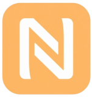

<p align="center">
  
</p>

<h1 align="center">🚀 NFC-BOS: Smart Borrowing System</h1>

<p align="center">
  <strong>Sistem Informasi Peminjaman & Pengembalian Aset Berbasis Web NFC, Integrasi Machine Learning (Random Forest), dan Gateway Notifikasi WhatsApp</strong>
</p>

<p align="center">
  <em>Dikembangkan sebagai Proyek Tugas Akhir / Skripsi — Program Studi Teknik Informatika</em>
</p>

<p align="center">
  
  
  
  
  
  
  
</p>

---

## 📌 Sekilas Proyek

**NFC-BOS (Borrowing System)** adalah platform manajemen peminjaman dan inventaris barang cerdas yang mengintegrasikan teknologi **Internet of Things (Web NFC)**, **Kecerdasan Buatan (Machine Learning)**, dan **Otomasi Pesan Singkat (WhatsApp Gateway)** dalam satu ekosistem web modern.

Sistem dirancang untuk mengatasi permasalahan pencatatan manual, lambatnya identifikasi fisik aset, minimnya analisis risiko keterlambatan pengembalian, serta keterlambatan pengingat peminjam di lingkungan laboratorium/institusi akademik.

```
                           +-------------------------------------+
                           |         Stiker NFC Tag (UID)        |
                           +-------------------------------------+
                                              |
                                              v  (Scan Tap HP Android)
                           +-------------------------------------+
                           |    Web NFC API (Chrome Browser)     |
                           +-------------------------------------+
                                              |
                                              v  (Inertia Vue SPA)
                           +-------------------------------------+
                           |        Laravel 12 REST Engine       |
                           +-------------------------------------+
                                      /               \
                                     v                 v
                 +-----------------------+         +-----------------------+
                 |  Scikit-Learn ML      |         |  WhatsApp Gateway     |
                 |  (Random Forest AI)   |         |  (Fonnte / Wablas)    |
                 +-----------------------+         +-----------------------+
```

---

## ✨ Fitur Unggulan

### 1. 📲 Peminjaman & Pengembalian Aset Berbasis Web NFC
- **Zero-Install Hardware Client**: Memanfaatkan **Web NDEFReader API** bawaan browser Chrome di Android untuk membaca serial UID stiker NFC secara instan tanpa perlu mengunduh aplikasi native.
- **Validasi Cepat**: Pencocokan otomatis ID stiker barang saat pengajuan pinjam maupun konfirmasi serah terima kembali.
- **Smart Fallback**: Dilengkapi antarmuka fallback modal apabila perangkat belum mendukung sensor NFC.

### 2. 🧠 Prediksi Keterlambatan dengan Machine Learning (Random Forest)
- Menggunakan algoritma **Random Forest Classifier (Scikit-Learn)** untuk memprediksi probabilitas keterlambatan pengembalian berdasarkan parameter:
  - Frekuensi riwayat pinjam peminjam sebelumnya (`prev_loans`).
  - Riwayat keterlambatan di masa lalu (`prev_late`).
  - Rasio keterlambatan peminjam (`late_ratio`).
  - Durasi peminjaman yang diajukan (`duration_days`).
  - Peran peminjam (`Mahasiswa` / `Dosen`).
  - Kategori barang yang dipinjam (`Elektronik`, `Jaringan`, `Komputer`, dll).
- Terintegrasi langsung dengan Laravel melalui bridge proses asynchronous untuk memberikan status evaluasi risiko (Aman / Berisiko Tinggi) pada dashboard admin.

### 3. 💬 Otomasi Pengingat & Notifikasi WhatsApp Gateway
- Pengiriman notifikasi peringatan otomatis berbasis cron scheduling (`notifikasi:kirim-pengingat`) yang berjalan setiap menit untuk mendeteksi transaksi 10 menit sebelum tenggat batas waktu.
- Manajemen template pesan dinamis:
  - Pengingat Batas Waktu H-1 / 10 Menit.
  - Peringatan Terlambat Ringan (1–2 hari).
  - Peringatan Terlambat Berat (3+ hari) & info denda.
  - Pelaporan barang rusak / hilang.
- Tombol aksi **Broadcast WhatsApp Peminjam** langsung dari tabel dashboard admin.

### 4. 🔐 Autentikasi Modern & Multi-Role
- **Google OAuth 2.0 Single Sign-On (SSO)**: Mahasiswa dapat masuk langsung menggunakan akun Google institusi/pribadi.
- **Auto-Onboarding (Complete Profile)**: Form pengisian identitas otomatis (NIM, nomor WhatsApp, peran) pada login pertama kali.
- **Role-Based Access Control (RBAC)**:
  - **Admin**: Akses kendali penuh (Master Data Barang, Data Peminjam, Approval Workflow, Analitik Prediksi, Log Denda, Audit Trail).
  - **User/Mahasiswa**: Akses mandiri (Katalog Barang, Formulir Pinjam NFC, Pengembalian NFC, Riwayat Transaksi).

---

## 🛠️ Arsitektur & Teknologi

| Lapisan | Teknologi | Deskripsi |
| :--- | :--- | :--- |
| **Backend** | **Laravel 12 (PHP 8.3+)** | Framework MVC utama, Eloquent ORM, REST API, Sanctum, Artisan Scheduler |
| **Frontend** | **Vue 3 (Composition API)** | Reactive UI modern dengan `<script setup>` |
| **SPA Bridge** | **Inertia.js v2.0** | Server-Driven SPA tanpa kompleksitas build REST endpoint manual |
| **Styling** | **Tailwind CSS + Flowbite** | Desain responsif, modern card system, UI micro-interaction |
| **Machine Learning**| **Python 3.10+ & Scikit-Learn** | Model Random Forest (`joblib`), Pandas, NumPy |
| **Hardware / IoT** | **Web NFC (NDEFReader API)** | Protokol pembacaan stiker NFC melalui browser Google Chrome |
| **Notifikasi** | **WhatsApp API (Fonnte / Wablas)** | HTTP Gateway pengiriman pesan otomatis ke nomor HP pengguna |
| **Database** | **MySQL / SQLite** | Penyimpanan data relasional transaksi, aset, dan riwayat |

---

## 📂 Struktur Direktori Proyek

```plaintext
├── app/
│   ├── Console/Commands/        # Artisan Cron Job (KirimPengingatOtomatis)
│   ├── Http/Controllers/
│   │   ├── Admin/               # Controller Master Data, Approval, Prediksi
│   │   ├── Auth/                # Login, Register, Google OAuth, Profile Completion
│   │   ├── NfcLoanController.php# Bridge integrasi Frontend NFC ke Skrip Python ML
│   │   └── PeminjamanController.php
│   ├── Models/                  # Barang, Peminjaman, Pengembalian, Pengajuan, User
│   └── Services/                # WhatsAppGateway & NotifikasiService
├── database/
│   ├── migrations/              # Skema tabel database
│   └── seeders/                 # Seeder akun admin & data demo
├── ml_scripts/                  # Modul Machine Learning
│   ├── dataset.json             # Dataset riwayat transaksi peminjaman
│   ├── train_rf.py              # Script pelatihan model Random Forest
│   ├── predict_rf.py            # Script inferensi prediksi real-time
│   ├── model_rf.joblib          # Bobot model terlatih
│   └── requirements.txt         # Dependensi Python
├── public/                      # Static assets, gambar NFC, stiker aset
├── resources/
│   ├── js/
│   │   ├── Components/          # ScanNfcPanel, DataTable, Sidebar, Modals
│   │   ├── Layouts/             # SidebarLayout & GuestLayout
│   │   ├── Pages/Admin/         # Tampilan Panel Admin (Dashboard, Prediksi, Barang)
│   │   ├── Pages/User/          # Tampilan Pengguna (Pinjam, Kembali, Riwayat)
│   │   └── nfc.js               # Handler API Web NDEFReader
│   └── views/app.blade.php      # Root HTML template
└── routes/
    ├── web.php                  # Rute portal pengguna
    ├── admin.php                # Rute panel admin
    ├── auth.php                 # Rute autentikasi & Google SSO
    └── console.php              # Rute background scheduler
```

---

## ⚙️ Persyaratan Sistem

Pastikan perangkat lokal Anda telah terpasang:
- **PHP** `>= 8.3` (ekstensi `bcmath`, `curl`, `mbstring`, `openssl`, `pdo`, `tokenizer`, `xml`)
- **Composer** `>= 2.x`
- **Node.js** `>= 18.x` & **npm**
- **Python** `>= 3.10` & **pip**
- **HP Android berfitur NFC** & browser **Google Chrome** (untuk pengujian Web NFC langsung)
- **Ngrok** / local tunnel HTTPS (wajib untuk Web NFC karena membutuhkan *Secure Context/HTTPS*)

---

## 🚀 Panduan Instalasi & Menjalankan Lokal

### 1. Kloning Repositori
```bash
git clone https://github.com/BaridNst/TUGAS-AKHIR.git
cd TUGAS-AKHIR
```

### 2. Instalasi Dependensi PHP & JavaScript
```bash
# Install PHP vendor packages
composer install

# Install Node modules
npm install
```

### 3. Konfigurasi Lingkungan (.env)
Salin berkas contoh konfigurasi:
```bash
cp .env.example .env
php artisan key:generate
```

Sesuaikan parameter `.env` berikut:
```env
APP_NAME="NFC Borrowing System"
APP_URL=http://localhost:8000

# Konfigurasi Database (MySQL)
DB_CONNECTION=mysql
DB_HOST=127.0.0.1
DB_PORT=3306
DB_DATABASE=db_peminjaman_nfc
DB_USERNAME=root
DB_PASSWORD=

# Google OAuth 2.0 (Untuk fitur Login Google)
GOOGLE_CLIENT_ID=isi_dengan_client_id_google_anda
GOOGLE_CLIENT_SECRET=isi_dengan_client_secret_google_anda
GOOGLE_REDIRECT_URI="${APP_URL}/auth/google/callback"

# WhatsApp Gateway (Fonnte / Wablas)
WHATSAPP_PROVIDER=fonnte
WHATSAPP_TOKEN=isi_dengan_token_fonnte_anda
```

### 4. Setup Lingkungan Python (Machine Learning)
Pasang pustaka dependensi Python untuk modul Random Forest:
```bash
cd ml_scripts
pip install -r requirements.txt

# (Opsional) Latih ulang model jika dataset diperbarui:
python train_rf.py
cd ..
```

### 5. Migrasi & Seeding Database
Jalankan migrasi tabel dan buat akun admin bawaan:
```bash
php artisan migrate --seed
```

> 🔑 **Akun Default Admin:**
> - **Username/Email**: `admin`
> - **Password**: `123456`
> - **Role**: `admin`

### 6. Menjalankan Aplikasi
Buka terminal dan jalankan server pengembangan:
```bash
# Terminal 1: Backend & Frontend Bundler
composer run dev
```
*(Perintah ini akan sekaligus menjalankan server Laravel artisan dan Vite dev server).*

### 7. Pengujian Fitur Web NFC di Smartphone (HTTPS)
Fitur Web NFC mewajibkan protokol **HTTPS (Secure Context)**. Gunakan script tunnel ngrok yang telah disediakan:
```bash
# Terminal 2: Buka tunnel HTTPS port 8000
.\http.ngrok.bat 8000
```
Buka URL `https://xxxx.ngrok-free.app` yang dihasilkan di browser **Google Chrome HP Android Anda**, lalu tap stiker NFC ke bagian belakang bodi handphone.

---

## 🧪 Menjalankan Pengujian Otomatis (Testing)

Proyek ini dilengkapi dengan Feature & Unit Test komprehensif menggunakan PHPUnit:
```bash
php artisan test
```

Mencakup skenario pengujian:
- Flow autentikasi & registrasi pengguna
- CRUD Master Data Barang & Peminjam
- Alur pemindaian NFC (`NfcScanFlowTest`)
- Persetujuan & Penolakan Pengajuan Peminjaman/Pengembalian
- Proteksi rute otorisasi berbasis Role Admin

---

## 👨‍💻 Penulis & Pengembang

* **A. Barid Dinda Khair Nasution**
  - Email: [baridnst23@gmail.com](mailto:baridnst23@gmail.com)
  - GitHub: [@BaridNst](https://github.com/BaridNst)

---

## 📄 Lisensi

Proyek ini dikembangkan untuk keperluan akademik Tugas Akhir dan dilisensikan di bawah [MIT License](LICENSE).
